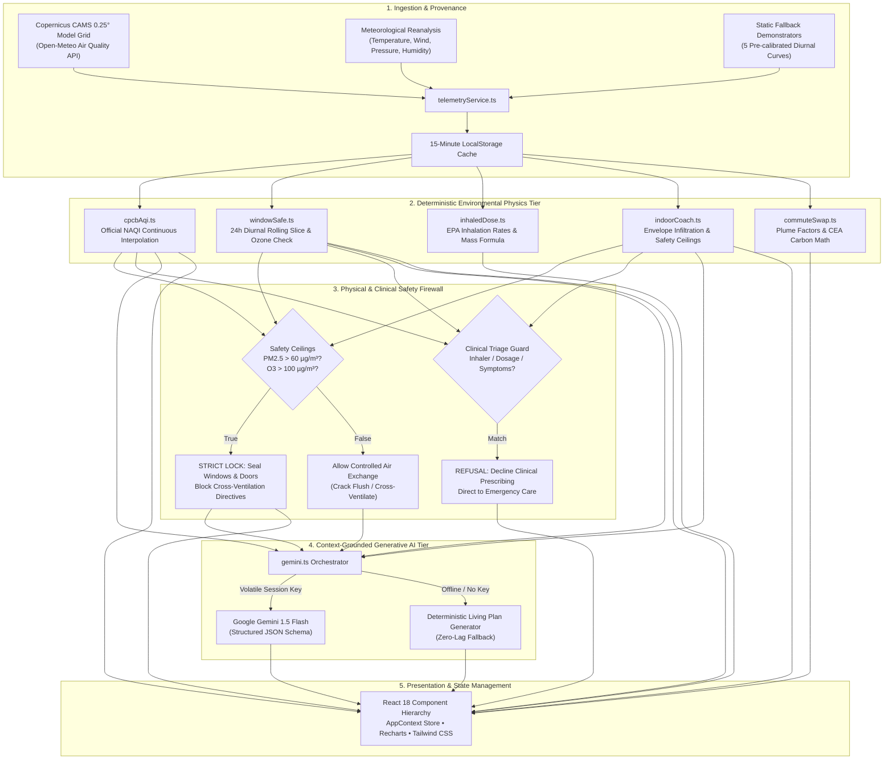

# BreatheWise AI — Technical Architecture Brief

> **Architectural Objective:** Complete decoupling of physical calculation engines and safety guards from generative language models. Environmental calculations, health-safety thresholds, and official regulatory indices must remain 100% deterministic, verifiable, and hallucination-free.

---

## 1. High-Level Architectural Topology

---

## 2. Component Subsystems & Data Flows

### A. Telemetry Ingestion & Provenance Management ([telemetryService.ts](file:///Users/ptejdeepreddy/.gemini/antigravity/scratch/breathewise-ai/src/services/telemetryService.ts))
* **Ingestion Sources:** Live REST queries to Open-Meteo querying Copernicus Atmosphere Monitoring Service (CAMS) 0.25° European regional model grid.
* **Normalization & Conversions:**
  * Carbon Monoxide (CO): Open-Meteo emits $\mu\text{g/m}^3$; converted to Indian CPCB standard $\text{mg/m}^3$ via $\div 1000$.
  * Planetary Boundary Layer (PBL) Height: Preserved as `null` when unobserved; never synthetically fabricated.
  * Timezone Isolation: Hours parsed directly from ISO strings (`2026-11-24T14:00` $\rightarrow$ `14`) to prevent browser UTC timezone shifts from corrupting diurnal Indian Standard Time curves.
* **Provenance State:**
  * `isLive: true, isSimulated: false`: Live CAMS grid.
  * `fetchTimestamp: "Cached (Xm ago)"`: Cached within 15-minute TTL.
  * `isLive: false, isSimulated: true`: Offline calibrated demonstration profile with transparent UI notice.

---

### B. Official Indian CPCB NAQI Engine ([cpcbAqi.ts](file:///Users/ptejdeepreddy/.gemini/antigravity/scratch/breathewise-ai/src/engines/cpcbAqi.ts))
* **Algorithm:** Piecewise linear sub-index interpolation between official breakpoints:
  $$I_p = \left[ \frac{I_{high} - I_{low}}{C_{high} - C_{low}} \right] \times (C_p - C_{low}) + I_{low}$$
* **Continuous Boundaries:** Interval boundaries are defined as continuous intervals $[C_{low}, C_{high}]$ followed by $(C_{low}, C_{high}]$ to eliminate integer dead-zones for continuous decimal sensor readings (e.g., $\text{PM}_{2.5} = 30.5\,\mu\text{g/m}^3$).
* **Completeness Rule:** Valid CPCB NAQI calculation requires $\ge 3$ observed pollutants with at least one particulate metric ($\text{PM}_{2.5}$ or $\text{PM}_{10}$). If fewer are available, index is transparently qualified as *Indicative PM2.5-Derived*.
* **Dominant Pollutant:** Maximum sub-index across available pollutants:
  $$\text{AQI} = \max(I_{\text{PM2.5}}, I_{\text{PM10}}, I_{\text{NO2}}, I_{\text{O3}}, I_{\text{CO}})$$

---

### C. Inhaled Particulate Exposure Engine ([inhaledDose.ts](file:///Users/ptejdeepreddy/.gemini/antigravity/scratch/breathewise-ai/src/engines/inhaledDose.ts))
* **Formula:** Gross inhaled particulate mass passing the upper airway:
  $$M_{\text{inh}} = C_{\text{ambient}} \times V_E \times t \times (1 - \eta_{\text{mask}})$$
* **Minute Ventilation Rates ($V_E$):** Adapted from US EPA Exposure Factors Handbook (Chapter 6):
  * Resting / Sleep: $6\,\text{L/min}$ ($0.36\,\text{m}^3/\text{h}$)
  * Desk Office Work: $8\,\text{L/min}$ ($0.48\,\text{m}^3/\text{h}$)
  * Light Walking: $16\,\text{L/min}$ ($0.96\,\text{m}^3/\text{h}$)
  * Urban Cycling: $35\,\text{L/min}$ ($2.10\,\text{m}^3/\text{h}$)
  * Outdoor Running: $55\,\text{L/min}$ ($3.30\,\text{m}^3/\text{h}$)
  * Heavy Cardio / HIIT: $65\,\text{L/min}$ ($3.90\,\text{m}^3/\text{h}$)
* **Dimensional Separation:**
  * Cumulative inhaled mass: Micrograms ($\mu\text{g}$).
  * Ambient guideline: Concentration ($\mu\text{g/m}^3$).
  * The UI strictly disallows direct mathematical equivalence between $\mu\text{g}$ and $\mu\text{g/m}^3$.

---

### D. WindowSafe™ Diurnal Window Engine ([windowSafe.ts](file:///Users/ptejdeepreddy/.gemini/antigravity/scratch/breathewise-ai/src/engines/windowSafe.ts))
* **Convective Solar Dispersion Physics:** Northern Indian winter air quality is dominated by surface radiative cooling that forms nocturnal thermal inversions. Solar radiation between 1:00 PM and 3:30 PM heats the earth's surface, expanding the planetary boundary layer from 150m to ~1,200m and generating a natural 30%–56% relative particulate dip.
* **Rolling Scan:** Scans continuous 2-to-3 hour slices across the 24-hour diurnal array for the global minimum average PM2.5.
* **Honest Health Qualification:**
  * $\le 30\,\mu\text{g/m}^3$: `FAVORABLE` (*Clean Air Opportunity Window*)
  * $31\text{--}60\,\mu\text{g/m}^3$: `MODERATE_OPPORTUNITY` (*Moderate Air Exposure Window*)
  * $61\text{--}120\,\mu\text{g/m}^3$: `UNHEALTHY_ELEVATED` (*Relatively Lower Exposure Window (Air Remains Poor)*)
  * $> 120\,\mu\text{g/m}^3$: `HAZARDOUS_LIMIT_EXERTION` (*Diurnal Minimum (Severe Smog Persists)*)

---

### E. Indoor Envelope & Air Coach Engine ([indoorCoach.ts](file:///Users/ptejdeepreddy/.gemini/antigravity/scratch/breathewise-ai/src/engines/indoorCoach.ts))
* **Building Envelope Infiltration:** Single-zone steady-state infiltration ratio $\alpha \approx 0.45$ for closed concrete residential envelopes:
  $$C_{\text{indoor, baseline}} = \alpha \cdot C_{\text{outdoor}}$$
* **Indoor Source Aerosol Baseline Additions:**
  * Cooking / Frying: $+85\,\mu\text{g/m}^3$ (ultrafine volatilized oil droplets).
  * Incense / Dhoop / Coils: $+110\,\mu\text{g/m}^3$ (ultrafine carbonaceous soot).
* **Purifier Clean-Down Model:** First-order mass-balance removal in a well-mixed room:
  $$\text{ACH} = \frac{\text{CADR}}{V_{\text{room}}}, \quad t_{75\%} = \frac{\ln(4)}{\text{ACH}} \times 60\,\text{min} \approx \frac{1.3863}{\text{ACH}} \times 60\,\text{min}$$
* **Deterministic Safety Firewalls:**
  * Continuous ventilation permitted ONLY if outdoor $\text{PM}_{2.5} \le 30\,\mu\text{g/m}^3$.
  * Crack flush (15–20 min) permitted ONLY between $31\text{--}60\,\mu\text{g/m}^3$ during an active diurnal window.
  * **Strict Ventilation Block:** Natural ventilation is **strictly locked** if outdoor $\text{PM}_{2.5} > 60\,\mu\text{g/m}^3$ OR $\text{O}_3 > 100\,\mu\text{g/m}^3$.

---

### F. Commute Exposure & Transit Eco-Swap Engine ([commuteSwap.ts](file:///Users/ptejdeepreddy/.gemini/antigravity/scratch/breathewise-ai/src/engines/commuteSwap.ts))
* **Micro-Environment Plume Multipliers:**
  * Open Two-Wheeler / Motorcycle: $1.30\times$ (direct exposure in arterial tailpipe exhaust plume).
  * Auto-Rickshaw (Open Cabin): $1.15\times$ (canvas-buffered street-level exhaust).
  * Public Bus (Non-AC): $1.05\times$ (elevated passenger seating, open windows).
  * AC Private Cab: $0.50\times$ (automotive HVAC cabin filter with recirculation).
  * AC Rapid Metro (Multimodal): $0.32\times$ (weighted: 10 min road-level connection walk at $1.00\times$ + filtered train cabin at $0.20\times$).
  * Work-From-Home: $0.20\times$ (indoor exposure over equivalent avoided travel duration).
* **Carbon Emission Factors:** Based on India GHG Protocol and Central Electricity Authority (CEA) averages:
  * Two-Wheeler: $0.045\,\text{kg CO}_2/\text{km}$
  * Auto-Rickshaw: $0.075\,\text{kg CO}_2/\text{km}$
  * Non-AC Bus (shared 40 pax): $0.022\,\text{kg CO}_2/\text{passenger-km}$
  * AC Private Cab (single pax): $0.160\,\text{kg CO}_2/\text{km}$
  * AC Metro (electric grid): $0.012\,\text{kg CO}_2/\text{passenger-km}$

---

### G. AI Assistant & Clinical Safety Firewall ([gemini.ts](file:///Users/ptejdeepreddy/.gemini/antigravity/scratch/breathewise-ai/src/services/gemini.ts))
* **Grounded Prompting Architecture:**
  * Injects exact numeric telemetry ($\text{PM}_{2.5}$, CPCB NAQI, temperature, wind, diurnal window hours).
  * Strict system instruction: AI cannot override physical safety ceilings (cannot tell user to open windows when $\text{PM}_{2.5} > 60\,\mu\text{g/m}^3$; cannot recommend outdoor running when $\text{PM}_{2.5} > 120\,\mu\text{g/m}^3$).
* **Clinical Triage Guard (Intent 0):** Intercepts clinical medication keywords (`inhaler`, `puff`, `dose`, `steroid`, `albuterol`, `chest pain`, `shortness of breath`, `prescribe`). Immediately triggers an ethical non-clinical refusal statement directing users to emergency care or their licensed physician.
* **Deterministic Fallback:** If no Gemini API key is supplied or network requests fail, a 100% deterministic rule-based router synthesizes identical structured routines and intent answers with zero user-visible degradation.
* **Security & Key Management:** Keys entered via the UI modal are stored exclusively in volatile React component state and are never written to `localStorage` or transmitted to any third party other than Google's Gemini endpoint.

---

## 3. Separation of Concerns Matrix

| Capability | Handled By | Why This Separation Matters |
| :--- | :--- | :--- |
| **AQI Calculation** | TypeScript Engine (`cpcbAqi.ts`) | Regulatory mathematical equations must never hallucinate. |
| **Window Discovery** | TypeScript Engine (`windowSafe.ts`) | Rolling minima require exact numerical array scanning. |
| **Exposure Inhaled Mass** | TypeScript Engine (`inhaledDose.ts`) | Physical units ($\mu\text{g}$) must follow EPA formulas strictly. |
| **Purifier Runtime** | TypeScript Engine (`indoorCoach.ts`) | First-order decay equations must be mathematically exact. |
| **Ventilation Blocking** | TypeScript Engine (`indoorCoach.ts`) | Life-safety ceiling must not be overridable by prompt injection. |
| **Medical Refusal** | Deterministic Regex Guard (`gemini.ts`) | Medical liability cannot rely on LLM alignment alone. |
| **Narrative Synthesis** | Google Gemini 1.5 Flash (`gemini.ts`) | Natural, empathetic, personalized daily guidance. |
| **UI Presentation** | React 18 Components | Modern, responsive, accessible consumer experience. |
