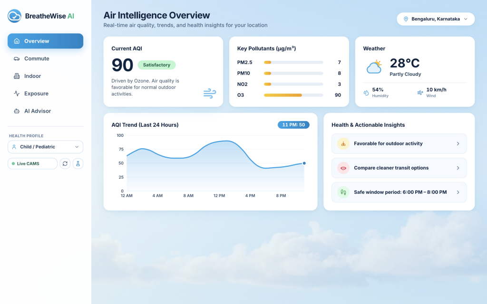
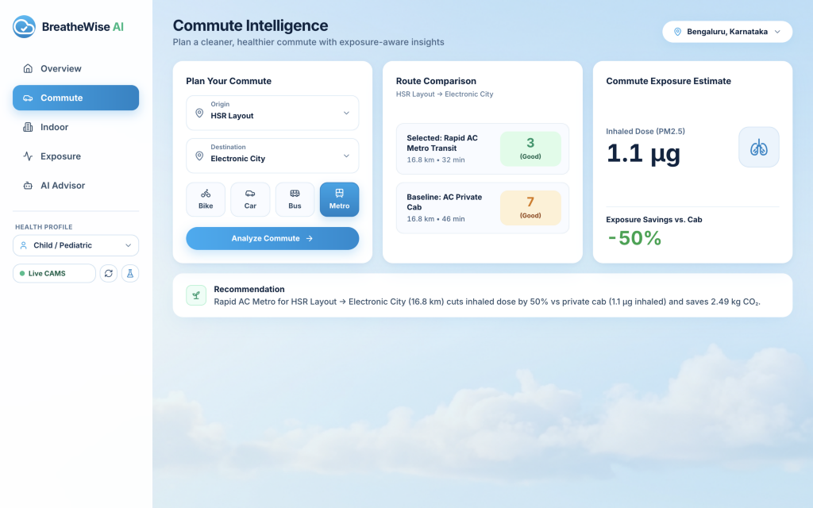
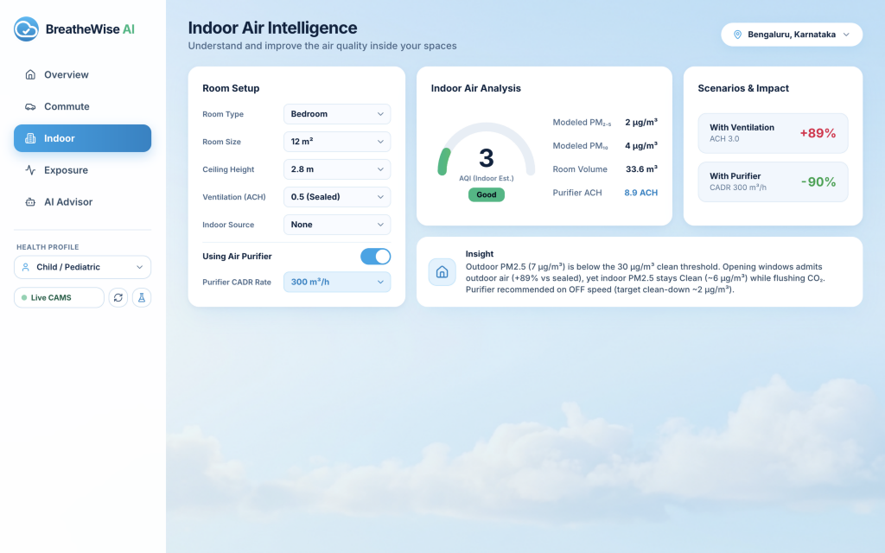
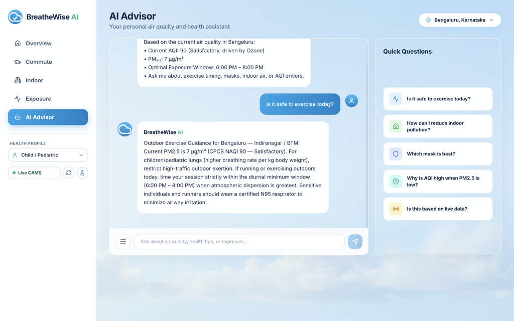
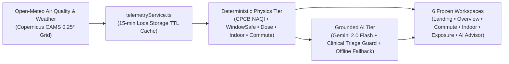

# BreatheWise AI — Personal Air Intelligence & Exposure-Aware Living Assistant

> *"Don't just understand the air. Understand how to live in it."*

[](https://promptwars.in)
[](https://tejdeepreddy37.github.io/breathewise-ai/)
[](https://www.typescriptlang.org/)
[](https://react.dev/)
[](https://tailwindcss.com/)
[](https://deepmind.google/technologies/gemini/)
[](scripts/test-engines.js)

**Live App:** [https://tejdeepreddy37.github.io/breathewise-ai/](https://tejdeepreddy37.github.io/breathewise-ai/)  
**Repository:** [https://github.com/tejdeepreddy37/breathewise-ai](https://github.com/tejdeepreddy37/breathewise-ai)

---

## 1. Executive Summary & Problem Statement

Legacy air quality apps stop at raw numbers (*"AQI is 124 — Moderate"*), while generic chatbots offer vague advice (*"Stay indoors and wear a mask"*). Neither answers the practical daily decisions urban residents across India actually face:

1. *"What is driving today's AQI in my city, and which 2–3 hour diurnal window has the lowest exposure?"*
2. *"If I switch my commute corridor from a private cab or open two-wheeler to the AC Metro, how many µg of $\text{PM}_{2.5}$ and kg of $\text{CO}_2$ do I avoid?"*
3. *"If I cook or burn incense indoors, should I open windows or run my HEPA purifier—and what happens to modeled indoor $\text{PM}_{2.5}$?"*
4. *"For a specific activity, duration, and mask (e.g., N95), how much particulate mass actually enters my airways?"*

**BreatheWise AI** bridges this **Actionability Chasm**. It is an **exposure-aware decision intelligence application** combining live atmospheric telemetry, official Indian CPCB NAQI standards, deterministic environmental physics engines, vulnerability-profile personalization, and a grounded Google Gemini 2.0 Flash AI Advisor with an unconditional clinical triage guard.

---

## 2. Application Screenshots (Verified Production Build)

| 1. 3D Earth Landing Page | 2. Air Intelligence Overview |
| :---: | :---: |
|  |  |

| 3. Commute Intelligence | 4. Indoor Air Intelligence |
| :---: | :---: |
|  |  |

| 5. Exposure / What-If Analysis | 6. AI Advisor |
| :---: | :---: |
|  |  |

---

## 3. Six-Screen Workspace Architecture

1. **Earth Landing Page (`LandingPage.tsx` + `InteractiveGlobe.tsx`):** Full-viewport interactive Three.js 3D Earth hero with atmospheric glow, orbital rings, and direct entry into the intelligence workspaces.
2. **Overview (`OverviewWorkspace.tsx`):** Displays live/cached Indian CPCB NAQI (`calculateCpcbAqi`), dominant pollutant driver (`PM2.5`, `PM10`, `NO2`, `O3`), weather conditions (temperature, humidity, wind), a 24-hour diurnal AQI trend chart, and clickable Health & Actionable Insights linked to deeper workspaces.
3. **Commute (`CommuteSimulator.tsx`):** Interactive Origin → Destination corridor selector with draft-vs-committed analysis (`Analyze Commute →`). Compares 4 primary UI modes (`Bike`, `Car`, `Bus`, `Metro`) and 6 engine modes (`commuteSwap.ts`) for route AQI, inhaled $\text{PM}_{2.5}$ dose ($\mu\text{g}$), percentage exposure savings vs. private cab baseline, and $\text{CO}_2$ savings ($\text{kg}$).
4. **Indoor (`IndoorCoachView.tsx`):** Single-zone steady-state mass-balance model (`indoorCoach.ts`) with Room Type, Size ($\text{m}^2$), Ceiling Height ($\text{m}$), Ventilation ($\text{ACH}$), Indoor Source (`None`, `Cooking / Frying`, `Incense / Dhoop`, `Candles`), and Air Purifier CADR toggle. Enforces strict outdoor smog safety ceilings ($\text{PM}_{2.5} > 60\,\mu\text{g/m}^3$ or $\text{O}_3 > 100\,\mu\text{g/m}^3$ blocks natural window ventilation).
5. **Exposure (`WhatIfSimulator.tsx`):** Physiological What-If Sandbox (`inhaledDose.ts`) computing gross inhaled $\text{PM}_{2.5}$ mass ($M_{\text{inh}} = C_{\text{ambient}} \times V_E \times t \times (1 - \eta_{\text{mask}})$) across US EPA minute ventilation rates ($V_E$) and mask tiers (`None`, `Cloth`, `Surgical`, `N95`, `N99`), with a side-by-side Recharts comparison bar chart.
6. **AI Advisor (`AiAssistantWorkspace.tsx` + `gemini.ts`):** Context-grounded assistant powered by **Google Gemini 2.0 Flash** (with optional session-only API key drawer in the bottom-left input bar) and a deterministic offline fallback. Automatically grounds responses in live location telemetry, active Health Profile (`General Adult`, `Child / Pediatric`, `Elderly`, `Respiratory Sensitive`, `Outdoor Athlete`), and active workspace scenario state—with an unconditional **Clinical Triage Guard** that intercepts medication/symptom queries before any LLM call.

### Cross-Cutting Intelligence Controls
* **State → District → City Location Picker (`IndiaLocationPicker.tsx`):** Covers all **36 Indian States & Union Territories** plus custom coordinate search.
* **Health Profile Selector & Provenance Bar (`Sidebar.tsx`):** Adjusts physiological guidance across 5 profiles, shows explicit telemetry status (`Live CAMS`, `Cached CAMS`, `Calibrated Baseline`, or `Unavailable`), allows manual refresh, and opens the **Scientific Methodology & Telemetry Provenance** modal (`TransparencyDrawer.tsx`).

---

## 4. Scientific Engines & Mathematical Foundations

| Engine | File | Methodology & Standards |
| :--- | :--- | :--- |
| **CPCB NAQI Engine** | `src/engines/cpcbAqi.ts` | Continuous piecewise linear interpolation across official Indian CPCB breakpoints ($\text{PM}_{2.5}$, $\text{PM}_{10}$, $\text{NO}_2$, $\text{O}_3$, $\text{CO}$, $\text{SO}_2$). |
| **WindowSafe™ Diurnal Engine** | `src/engines/windowSafe.ts` | Rolling 2–3 hour diurnal slice scan identifying lowest composite $\text{PM}_{2.5}$ + $\text{O}_3$ exposure window without false reassurance during severe smog. |
| **Inhaled Dose Engine** | `src/engines/inhaledDose.ts` | US EPA *Exposure Factors Handbook* (Ch. 6) minute ventilation rates ($6\text{--}65\,\text{L/min}$) + NIOSH nominal filtration efficiencies. |
| **Indoor Air Coach** | `src/engines/indoorCoach.ts` | Single-zone steady-state mass balance ($\alpha = 0.45$ closed envelope infiltration), CADR clean-down time ($t_{75\%}$), and strict outdoor smog/ozone safety locks. |
| **Commute Eco-Swap Engine** | `src/engines/commuteSwap.ts` | Micro-environment exposure factors ($1.30\times$ open two-wheeler plume factor, metro walk-link modeling) + India GHG Protocol $\text{CO}_2$ emission factors. |

---

## 5. System Architecture & Data Provenance



### Honest Telemetry & Provenance Disclosure
* **Atmospheric Model Grid:** Live data is fetched from Open-Meteo's European Copernicus Atmosphere Monitoring Service (**CAMS**) at a **$0.25^\circ \times 0.25^\circ$ regional grid** (~25 km resolution) with hourly updates. It is regional atmospheric modeling rather than a hyper-local street-corner hardware sensor.
* **Fallback Transparency:** When offline or unreachable, calibrated presets transparently report `Calibrated Baseline`, and uncalibrated custom locations report `Telemetry Unavailable` rather than fabricating live sensor readings.
* **Non-Medical Boundary:** BreatheWise AI is an environmental exposure-reduction planning tool, not a clinical diagnostic or prescription service.

---

## 6. Tech Stack

| Layer | Technologies |
| :--- | :--- |
| **Frontend** | React `18.3.1`, TypeScript `5.6.3`, Vite `5.4.11` |
| **Styling** | Tailwind CSS `3.4.15`, `clsx`, `tailwind-merge` |
| **3D & Visualization** | Three.js `0.187.0` (3D Earth Globe), Recharts `2.13.3` (24h Trend & Exposure Charts), Lucide React `0.460.0` |
| **Generative AI** | `@google/generative-ai` (`0.21.0`) targeting `gemini-2.0-flash` + deterministic fallback |
| **Testing** | Node.js test harness (`scripts/test-engines.js` — **256 Passed, 0 Failed**) |

---

## 7. Local Setup & Verification

### Prerequisites
* **Node.js** v18+ (tested on Node v22)
* **npm** v9+

### Commands
```bash
# 1. Clone the repository
git clone https://github.com/tejdeepreddy37/breathewise-ai.git
cd breathewise-ai

# 2. Install dependencies
npm install

# 3. Run the deterministic engine & safety test suite (256 assertions)
npm test

# 4. Type-check and build production bundle
npm run build

# 5. Start local production preview server
npm run preview -- --port 4178 --strictPort --host 127.0.0.1
```

### Optional Gemini API Key Configuration
BreatheWise AI works **out-of-the-box with zero API keys** using its deterministic physics and rule-based advisor engine. To enable live **Google Gemini 2.0 Flash** synthesis:
* **Option A (In-App Session Key):** Open **AI Advisor**, click the settings icon on the left side of the message bar, and paste your Google AI Studio key. It is stored only in `sessionStorage` and cleared when the browser tab closes.
* **Option B (Local `.env.local`):** Copy `.env.example` to `.env.local` and set:
  ```env
  VITE_GEMINI_API_KEY=your_gemini_api_key_here
  ```

---

## 8. Authoritative References & License

1. **Central Pollution Control Board (CPCB), India:** *National Air Quality Index Technical Report* — piecewise linear breakpoint schedules.
2. **World Health Organization (WHO):** *Global Air Quality Guidelines (2021)* — 24h $\text{PM}_{2.5}$ ($15\,\mu\text{g/m}^3$) and 8h $\text{O}_3$ ($100\,\mu\text{g/m}^3$) benchmarks.
3. **US EPA:** *Exposure Factors Handbook (2011, Ch. 6)* — activity-specific minute ventilation rates ($V_E$).
4. **India GHG Protocol / CEA:** Urban passenger transport emission factors ($\text{kg CO}_2/\text{km}$).
5. **NIOSH 42 CFR Part 84:** Particulate respirator filtration classes (N95 / N99).

**Event:** PromptWars Virtual — Challenge 06: Urban Air Quality  
**License:** MIT
