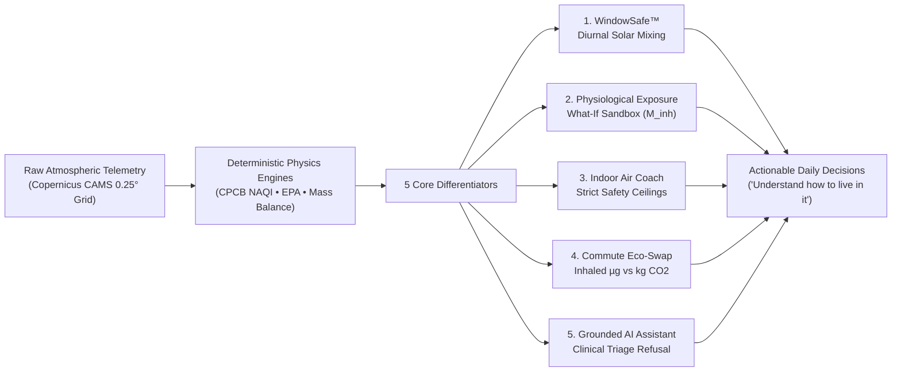
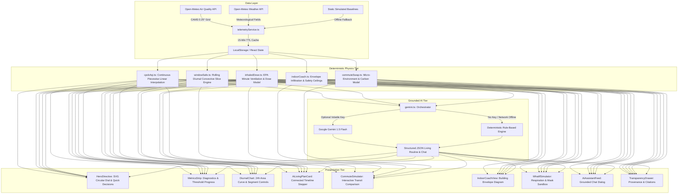

# BreatheWise AI — Personal Air Intelligence & Exposure-Aware Living Assistant

> *"Don't just understand the air. Understand how to live in it."*

[](https://promptwars.dev)
[](https://www.typescriptlang.org/)
[](https://react.dev/)
[](https://tailwindcss.com/)
[](https://deepmind.google/technologies/gemini/)
[](scripts/test-engines.js)

---

## 1. Executive Summary & Problem Statement

Air quality applications have historically been trapped in the **Measurement Paradigm**:
* Legacy AQI dashboards tell you: *"The AQI is 342 (Hazardous)."*
* Generic chatbots tell you: *"Stay indoors and wear a mask."*

Neither answers the practical dilemmas that millions of urban citizens face every day in Indian metropolitan centers like Delhi NCR, Mumbai BKC, Bengaluru, Kolkata, and Chennai:
1. *"When is the exact daytime window today to ventilate my apartment without flooding my living space with hazardous outdoor smog?"*
2. *"Can I take my 6-year-old asthmatic child outdoors for physical recreation today?"*
3. *"If I switch my 14 km commute from a motorcycle to the AC Metro, how many micrograms (µg) of fine particulate matter do I avoid inhaling?"*
4. *"If I cook or burn incense indoors, how many minutes must my HEPA purifier run on Turbo to clean the room?"*

**BreatheWise AI** bridges this Actionability Chasm. It is not an AQI dashboard with a chatbot taped onto it. It is an **exposure-aware decision intelligence assistant** that couples deterministic environmental physics, official Central Pollution Control Board (CPCB) standards, and physiological inhalation equations with context-grounded Generative AI synthesis.

---

## 2. The 5 Core Differentiators



### 1. WindowSafe™ Diurnal Activity Window Discovery
In northern and peninsular India, morning traffic peaks and nocturnal radiative surface cooling create ground-level thermal inversions that trap emissions below a 100–200m boundary layer. Between 1:00 PM and 3:30 PM, solar surface heating breaks this inversion cap, triggering vertical convective boundary-layer mixing that produces a natural **30% to 56% relative particulate dispersion valley**. BreatheWise scans the 24-hour diurnal curve to find this window, tracks photochemical Ozone ($O_3$) spikes, and applies strict health labeling: relative valleys during severe smog episodes are honestly labeled as *"Diurnal Minimum (Severe Smog Persists)"*, avoiding false reassurance.

### 2. Physiological Exposure & "What-If" Sandbox ($M_{\text{inh}}$)
Standard consumer tools conflate outdoor atmospheric concentration ($\mu\text{g/m}^3$) with personal inhaled risk. BreatheWise models gross inhaled particulate mass passing the upper airway using US EPA minute ventilation parameters:
$$M_{\text{inh}} = C_{\text{ambient}} \times V_E \times t \times (1 - \eta_{\text{mask}})$$
Where $V_E$ ranges from $16\,\text{L/min}$ ($0.96\,\text{m}^3/\text{h}$) for light walking to $55\,\text{L/min}$ ($3.30\,\text{m}^3/\text{h}$) for running, and $\eta$ represents nominal certified mask material efficiency (95% for N95). The UI strictly separates cumulative inhaled mass ($\mu\text{g}$) from volumetric WHO ambient concentration guidelines ($\mu\text{g/m}^3$).

### 3. Indoor Envelope & Ventilation Safety Coach
Evaluates building envelope infiltration ($\alpha \approx 0.45$ for standard closed concrete structures) and models HEPA purifier clean-down runtime based on first-order well-mixed mass balance:
$$t_{75\%} = \frac{\ln(4)}{\text{ACH}} \times 60\,\text{min}, \quad \text{ACH} = \frac{\text{CADR}}{V_{\text{room}}}$$
**Strict Safety Guard:** Natural window ventilation is permitted only when outdoor $\text{PM}_{2.5} \le 30\,\mu\text{g/m}^3$ (or up to $60\,\mu\text{g/m}^3$ during diurnal dispersion windows). Ventilation is **strictly blocked whenever outdoor $\text{PM}_{2.5} > 60\,\mu\text{g/m}^3$ or Ozone $> 100\,\mu\text{g/m}^3$**, preventing outdoor smog from degrading indoor living spaces.

### 4. Commute Exposure & Transit Eco-Swap Simulator
Directly compares 6 urban transit modes (Open Two-Wheeler, Auto-Rickshaw, Non-AC Bus, AC Cab, Rapid AC Metro, and Work-From-Home) for customizable commute distances ($3\text{--}35\,\text{km}$). Captures street-level diesel exhaust plume concentration factors ($1.30\times$ for motorcycle riders) and models multimodal metro travel with a realistic 10-minute road-level connection walk. Simultaneously calculates personal health savings ($\mu\text{g}$ particulate avoided) and civic sustainability savings ($\text{kg CO}_2$ avoided based on India GHG Protocol factors).

### 5. Context-Aware AI Assistant with Clinical Triage Refusal
Powered by Google Gemini 1.5 Flash with a 100% reliable offline deterministic fallback. Every prompt is strictly bounded by deterministic telemetry and physical safety rules. Features an integrated **Clinical Triage Guard** that intercepts prescription inhaler questions, medication dosage queries, and acute respiratory symptoms, providing immediate ethical refusal statements and directing users to seek licensed medical or emergency care.

---

## 3. System Architecture



---

## 4. Tech Stack & Engineering Standards

| Layer | Technologies Used | Key Engineering Principles |
| :--- | :--- | :--- |
| **Frontend Framework** | React 18.3.1, TypeScript 5.6.3, Vite 5.4.11 | Pure client-side SPA; zero server dependency; deep-link URL state. |
| **Styling & Design** | Tailwind CSS 3.4.15 | Light-first palette (`cream-50`, `forest-600`, `sage-50`); soft elevated drop shadows; mobile-responsive layout. |
| **Data Visualization** | Recharts 2.13.3, Custom SVG | Responsive diurnal area chart with gradient fills and WHO guideline threshold lines; SVG radial AQI progress dial. |
| **Generative AI** | Google Gemini 1.5 Flash via `@google/generative-ai` | Strict JSON schema generation with defensive parsing; session-only volatile key storage; 100% deterministic offline fallback. |
| **Data Providers** | Copernicus Atmosphere Monitoring Service (ECMWF CAMS), Open-Meteo | 0.25° atmospheric model grid; timezone-safe ISO parsing; CO normalized to $\text{mg/m}^3$; unobserved PBL preserved as null. |
| **Testing** | Node.js Test Harness (`scripts/test-engines.js`) | 46 comprehensive unit and adversarial tests covering continuity, edge cases, negative values, and clinical safety refusals. |

---

## 5. Scientific Validation & Breakpoint Reference

### Official Indian CPCB NAQI Breakpoint Schedules
Sub-indices are computed using continuous piecewise linear interpolation:
$$I_p = \left[ \frac{I_{high} - I_{low}}{C_{high} - C_{low}} \right] \times (C_p - C_{low}) + I_{low}$$

Continuous breakpoint intervals eliminate dead-gaps for decimal concentrations:

| Category | Sub-Index ($I$) | $\text{PM}_{2.5}$ ($24\text{h},\,\mu\text{g/m}^3$) | $\text{PM}_{10}$ ($24\text{h},\,\mu\text{g/m}^3$) | $\text{NO}_2$ ($24\text{h},\,\mu\text{g/m}^3$) | $\text{O}_3$ ($8\text{h},\,\mu\text{g/m}^3$) | $\text{CO}$ ($8\text{h},\,\text{mg/m}^3$) |
| :--- | :---: | :---: | :---: | :---: | :---: | :---: |
| **Good** | 0 – 50 | 0 – 30 | 0 – 50 | 0 – 40 | 0 – 50 | 0.0 – 1.0 |
| **Satisfactory** | 51 – 100 | 30 – 60 | 50 – 100 | 40 – 80 | 50 – 100 | 1.0 – 2.0 |
| **Moderate** | 101 – 200 | 60 – 90 | 100 – 250 | 80 – 180 | 100 – 168 | 2.0 – 10.0 |
| **Poor** | 201 – 300 | 90 – 120 | 250 – 350 | 180 – 280 | 168 – 208 | 10.0 – 17.0 |
| **Very Poor** | 301 – 400 | 120 – 250 | 350 – 430 | 280 – 400 | 208 – 748 | 17.0 – 34.0 |
| **Severe** | 401 – 500 | 250 – 500 | 430 – 500 | 400 – 600 | 748 – 1000 | 34.0 – 50.0 |

*Data Completeness Requirement:* Official CPCB NAQI requires at least 3 observed pollutants with at least one particulate metric ($\text{PM}_{2.5}$ or $\text{PM}_{10}$). If fewer pollutants are observed, BreatheWise transparently labels the score as an *Indicative PM2.5-Derived Index*.

---

## 6. Running Locally & Verification

### Prerequisites
* **Node.js** v18.0.0 or higher (tested on Node v22)
* **npm** v9.0.0 or higher

### Quick Start
```bash
# 1. Clone repository
git clone https://github.com/your-username/breathewise-ai.git
cd breathewise-ai

# 2. Install dependencies
npm install

# 3. Run automated domain engine test suite
npm test

# 4. Run TypeScript check and production build
npm run build

# 5. Start production preview server
npm run preview
```
Open **`http://localhost:4173/`** in your browser.

### Optional Gemini API Configuration
BreatheWise operates with 100% full functionality out-of-the-box using its deterministic intelligence engines. If you wish to enable live Gemini 1.5 Flash generation:
* **Option A (UI Session Key):** Click the **"Gemini Key"** button in the header of the AI Assistant tab. Enter your Google AI Studio API key. The key is stored strictly in volatile memory and is purged upon tab refresh or exit.
* **Option B (Local Environment):** Copy `.env.example` to `.env.local` and set `VITE_GEMINI_API_KEY=your_key_here`.

---

## 7. 3-Minute Competition Judge Walkthrough Script

| Time | Segment | What to Show & Say |
| :---: | :--- | :--- |
| **0:00 – 0:20** | **The Actionability Chasm** | *"An AQI number tells you the air is bad. But it doesn't tell a mother when her asthmatic child can play outdoors, doesn't tell a commuter how to travel, and doesn't tell an apartment resident whether opening a window will poison their living space. BreatheWise AI transforms environmental data into practical daily decisions."* |
| **0:20 – 0:50** | **Air Intelligence Hero** | Point to the **CPCB NAQI Radial Dial** (Delhi 405 — Severe). Show the **3 Quick Lifestyle Decision Pills** (Outdoor Exercise: Shift Indoors; Window Ventilation: Keep Sealed; Commute Protocol: Prefer AC Metro / N95). Switch profile to **Child / Pediatric** to show physiological micro-guidance. |
| **0:50 – 1:20** | **WindowSafe™ Solar Mixing** | Scroll to the **WindowSafe 24-Hour Diurnal Chart**. Explain: In Indian cities, nocturnal inversions trap emissions overnight, but midday solar heating triggers convective boundary-layer mixing, dropping $\text{PM}_{2.5}$ by ~56% between 1:00 PM and 2:00 PM. Point out the scientific honesty: it is labeled *"Diurnal Minimum (Severe Smog Persists)"*, not falsely promised as clean air. |
| **1:20 – 1:55** | **Commute Eco-Swap Engine** | Click the **Commute Eco-Swap** tab. Set distance to **14 km**. Compare Riding a Motorcycle (inhales ~338 µg of $\text{PM}_{2.5}$ in road-level exhaust plumes, emits 0.63 kg $\text{CO}_2$) vs. **AC Metro Transit** (inhales only 35.7 µg including first/last-mile walking, emits 0.17 kg $\text{CO}_2$). Result: **-72% inhaled particulate reduction** and **0.46 kg $\text{CO}_2$ saved**. |
| **1:55 – 2:25** | **Indoor Envelope Coach** | Click the **Indoor Ventilation Coach** tab. Show the **Building Envelope Diagram** (Outdoor Ambient 265 µg/m³ $\rightarrow$ Sealed Barrier $\alpha=0.45$ $\rightarrow$ Indoor ~119 µg/m³). Notice the safety ceiling: ventilation is strictly locked. Click **"🍳 Cooking / Frying"**: Purifier fan speed immediately shifts to **TURBO** with specific kitchen isolation directives. |
| **2:25 – 2:50** | **What-If Sandbox & AI Chat** | Click **What-If Exposure Sandbox**: Show that running 45 min without a mask inhales 247.5 µg; donning an N95 respirator avoids 235.1 µg (95%). Switch to **AI Living Assistant**: Ask *"Can I open my apartment windows right now?"* Watch the grounded answer. Then ask *"Should I take 2 puffs of my inhaler?"* Watch the **Clinical Triage Guard** ethically refuse clinical diagnosis and direct the user to emergency care. |
| **2:50 – 3:00** | **The Closing Pitch** | *"BreatheWise AI is built on deterministic environmental physics, official CPCB standards, and grounded Gemini intelligence. Don't just understand the air. Understand how to live in it."* |

---

## 8. Authoritative References & Standards

1. **Central Pollution Control Board (CPCB), MoEFCC, Govt. of India:** *National Air Quality Index Technical Report* (2014/2015). Piecewise linear sub-index interpolation formulas and breakpoint tables.
2. **World Health Organization (WHO):** *Global Air Quality Guidelines* (2021 Update). 24-hour ambient $\text{PM}_{2.5}$ benchmark of $15\,\mu\text{g/m}^3$ and 8-hour Ozone benchmark of $100\,\mu\text{g/m}^3$.
3. **US Environmental Protection Agency (EPA):** *Exposure Factors Handbook* (2011 Edition, Chapter 6: Inhalation Rates). Activity-specific minute ventilation rates ($V_E$).
4. **India GHG Protocol & Central Electricity Authority (CEA):** *CO2 Baseline Database for the Indian Power Sector & Urban Transport Factors*.
5. **National Institute for Occupational Safety and Health (NIOSH):** 42 CFR Part 84 particulate respirator certification standards (N95: $\ge 95\%$ sodium chloride aerosol filtration).

---

## 9. Limitations & Responsible Environmental Guidance

* **Regional Resolution:** Regional atmospheric model data derived from Copernicus CAMS covers a $0.25^\circ \times 0.25^\circ$ spatial grid (~$25\,\text{km}\times 25\,\text{km}$). Micro-environments adjacent to heavy arterial flyovers or localized open biomass fires may experience higher ground-level concentrations than regional model averages.
* **Mask Seal Integrity:** Real-world particulate protection depends critically on perimeter facial fit; inward leakage around the nose clip or jawline reduces real-world exposure reduction below nominal material efficiency.
* **Non-Medical Nature:** BreatheWise AI is an environmental lifestyle intelligence and exposure-reduction planning assistant. It does not provide clinical medical diagnosis, disease prognosis, or pharmaceutical prescriptions. Individuals with chronic respiratory or cardiovascular conditions must follow their licensed physician's guidance.

---

## 10. License & Submission Info

* **Event:** PromptWars Virtual — Challenge 06: Urban Air Quality Assistant
* **Project Name:** BreatheWise AI
* **License:** MIT License
